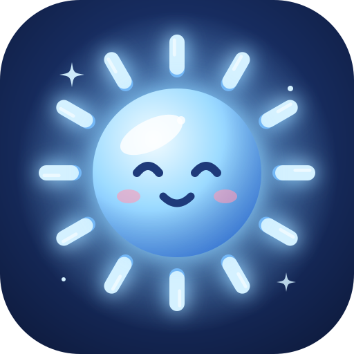
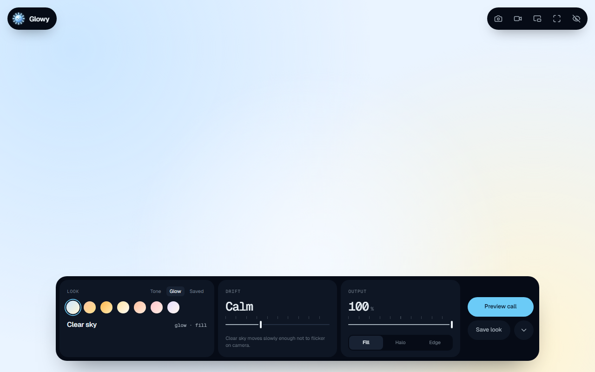
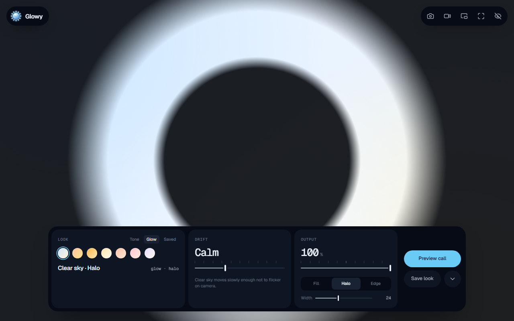
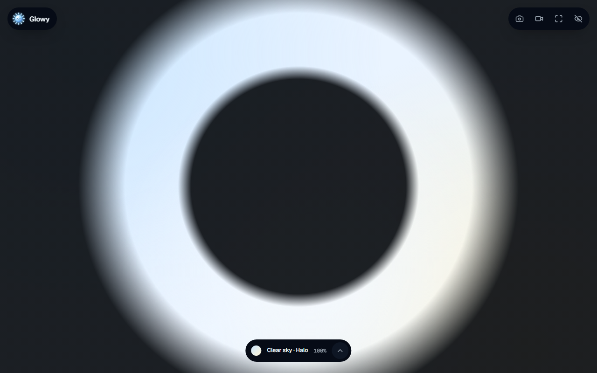
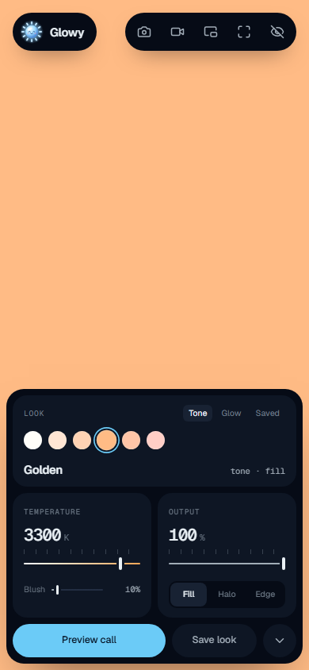
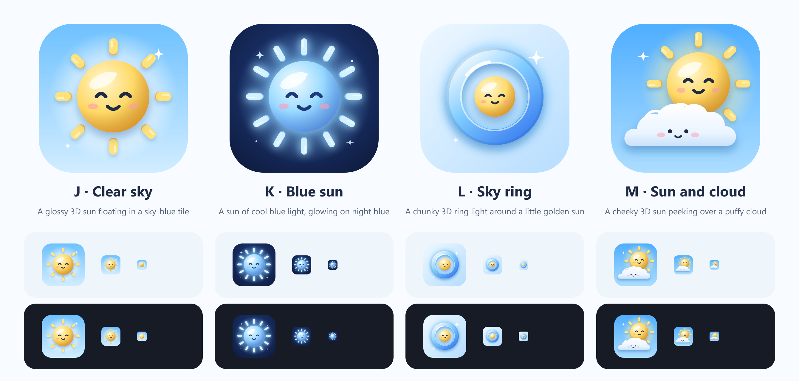

<p align="center">
  
</p>

<h1 align="center">Glowy</h1>

<p align="center">Turn any screen into a soft, flattering light for video calls.</p>

<p align="center">
  
</p>

Open Glowy on a laptop, a spare monitor, a tablet or a phone, point it at your face, and join your call. The screen becomes your ring light: warm daylight, slow golden glows, or a halo that puts a round sparkle in your eyes.

It's a small installable PWA with no account, no tracking and no server. Everything you change stays on your device.

<p align="center">
  
  
</p>

## What it does

**Light**
- **Tones**: Daylight, Soft white, Warm, Golden, Peach and Rose, plus a *Warmth* slider (2700–6500 K) and a *Blush* slider that leans the light toward a soft rose.
- **Glows**: seven slow-moving scenes (Clear sky, Sunrise, Golden hour, Sunbeam, Peach fizz, Rose quartz, Moonmilk). They drift gently enough not to flicker on camera, and *Drift* sets the pace.
- **Brightness** from 30% to 100%.

**Shape**
- **Fill**: the whole screen glows. The brightest option.
- **Halo**: a ring of light, like a real ring light. Gives you round catchlights.
- **Edge**: light only around the screen edges. Good on a second monitor or tablet, where the glow should frame rather than blind.

**Camera**
- **Mirror**: a small round self-view you can drag anywhere while you adjust the light.
- **Meeting preview**: your camera in a call-style grid, with a *Compare* slider. One side is your real feed, already lit by the screen. The other side simulates the current look at full strength, which helps when a small phone screen can't light you much.
- The camera turns on only while the mirror or preview is open, and nothing leaves the device.

**Made for calls**
- **Full screen** in one tap (`F`).
- **Wake lock** keeps the screen from sleeping mid-call. Look for *awake* next to the logo.
- **Auto-hide**: controls fade after 3.5 s of stillness. Move the mouse or tap to bring them back, or press `H` to hide them at once.
- **Pop out the light** (`O`) into a small always-on-top picture-in-picture window, so it can sit beside or over your meeting app. In Chrome and Edge the window is resizable and has its own hover controls (previous / next look, dimmer / brighter), kept in sync with the main app. In Safari it opens as a video picture-in-picture of the light.
- **Minimise the dock** (`M`, or the chevron beside *Save look*) to a small pill showing the current look and brightness. Glowy remembers whether you left it open or minimised.
- **Saved looks**: up to 8 favourites, stored locally under *Look → Saved*.
- Works offline once it's installed.

### Keyboard

| Key | Action |
| --- | --- |
| `F` | Full screen |
| `H` | Hide controls |
| `M` | Minimise / expand the dock |
| `O` | Pop out the light (picture-in-picture) |
| `C` | Camera mirror |
| `P` | Meeting preview |
| `←` `→` | Previous / next tone or glow |
| `↑` `↓` | Brightness ±5% |

## Tips for the best light

1. **Turn your display brightness all the way up.** Glowy can only be as bright as your screen.
2. Put the light **in front of you, at or slightly above eye level**. Light from below is spooky.
3. For a second screen or tablet, use **Edge** or **Halo** and angle it 30–45° toward your face.
4. Warm tones (Golden, Peach) flatter most skin in a dim room. Use Daylight or Soft white when there's a window nearby, so the colours match.
5. The camera can only be used by one app at a time on some systems (Windows especially). If the mirror says it's busy, check your look in your meeting app's self-view.

## Install it

Glowy is a Progressive Web App:

- **Chrome / Edge (Windows, macOS, Linux, ChromeOS, Android)**: use the install icon in the address bar, or *Menu → Install Glowy*.
- **Safari (iPhone / iPad)**: *Share → Add to Home Screen*.
- **Safari (macOS Sonoma+)**: *File → Add to Dock*.

## Develop

```bash
npm install
npm run dev       # http://localhost:5173
npm run build     # typecheck + production build in dist/
npm run preview   # serve the production build
npm run icons     # rebuild every icon from scripts/build-icons.mjs
```

The camera and wake lock need a secure context: `localhost` works, and any deployed copy must be served over **https**.

### Deploy to Cloudflare Workers

Glowy deploys as static assets on Cloudflare Workers; there is no Worker script. `wrangler.jsonc` points at `dist/` and serves `index.html` for unknown paths. `public/_headers` stops the service worker and manifest from being cached and caches hashed assets for a year.

```bash
npx wrangler login   # once
npm run deploy       # build + wrangler deploy
```

Your app is then live at `https://glowy.<your-subdomain>.workers.dev`. Add a custom domain from the Cloudflare dashboard if you like. Workers always serve over https, which the camera, wake lock and install prompt need.

**Deploying under a sub-path** (for example GitHub Pages at `/glowy/`):

```bash
BASE_PATH=/glowy/ npm run build
```

### Stack

- [Vite](https://vite.dev) + React 19 + TypeScript
- [vite-plugin-pwa](https://vite-pwa-org.netlify.app) (Workbox) for the manifest, offline cache and auto-update
- [lucide-react](https://lucide.dev) icons; Geist + Geist Mono, self-hosted via Fontsource
- No UI kit and no state library: plain CSS with design tokens in `src/styles/tokens.css`

### Project map

```
src/
  App.tsx                  shell: state, shortcuts, idle-hide, dock minimise
  lib/light.ts             tones, glow scenes, kelvin → colour, look names
  lib/persist.ts           localStorage-backed state
  hooks/useDevice.ts       idle timer, wake lock, full screen, camera
  hooks/usePip.ts          pop-out light: Document PiP, with a canvas → video PiP fallback
  components/LightStage    the light itself (tone / glow × fill / halo / edge)
  components/Dock          the instrument dock: look · temperature · output · actions
  components/Camera        draggable mirror + shared <video>
  components/MeetingPreview  call-grid preview with simulated compare
  components/PipLight      the light + hover controls inside the PiP window
  components/Sunny         the blue-sun mascot
  styles/tokens.css        colours, type, spacing, motion tokens
  styles/app.css           everything else
scripts/build-icons.mjs    PWA / favicon / Apple icons from one SVG
wrangler.jsonc             Cloudflare Workers static-assets config
public/_headers            cache + security headers for Cloudflare
design/icons/              icon mockups (three rounds)
design/ui/                 UI mockups; v2/ holds the atmospheric directions (A1 shipped)
```

## Design

The interface is direction **A1 · Instrument strip** (night-blue instrument panels, Geist type, mono readouts, one ice-blue accent) from four atmospheric options. The showcase that compares them lives in `design/ui/v2/showcase.html`.

<p align="center">
  
</p>

## The icon

The blue sun (K) was picked from three rounds of mockups in `design/icons/`. Rebuild a round with `node design/icons/build-mockups-v3.mjs`, and the shipped icons with `npm run icons`.

<p align="center">
  
</p>

## Accessibility

- Every control works from the keyboard and shows a visible focus ring.
- `prefers-reduced-motion` stops the glow drift and Sunny's animations. Light changes still fade, just faster.
- The layout is checked at 280 (foldable cover), 320, 360, 390, 600, 768, 1024, 1280, 1920 and 2560 px wide, plus landscape phones at 667×375 and 844×390, with nothing off-screen and no sideways scrolling.
